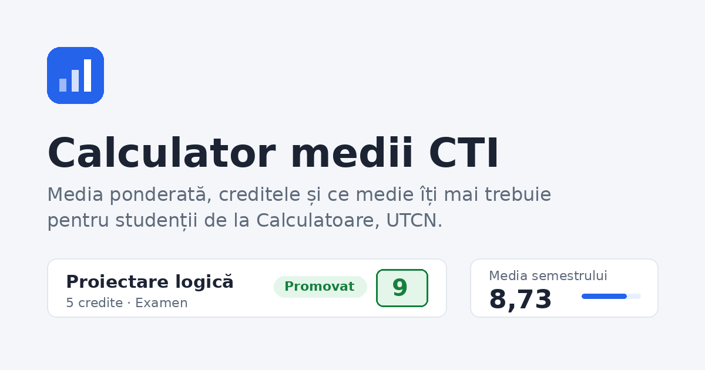
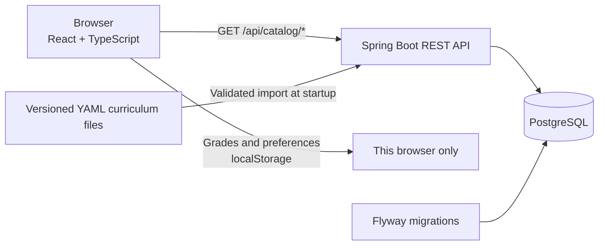
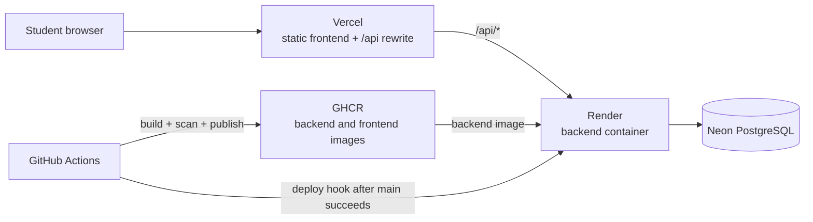

# Grade Planner — CTI

[](https://github.com/pop-dragos/grade-planner/actions/workflows/ci.yml)

**A full-stack grade planning application for Computer Science students.** Track semester and annual averages, monitor earned credits, and find practical ways to reach a target average.

- **Live app:** [grade-plannervercelapp.vercel.app](https://grade-planner-app.vercel.app/)
- **Current curriculum:** Calculatoare (Romanian), academic year 2026–2027
- **App language:** Romanian

> The image below is the project's branded Open Graph preview, not a live application screenshot. Real desktop and mobile captures are on the roadmap.



## Project overview

Grade Planner turns a university study plan into a practical tool students can use throughout the academic year. It combines a versioned curriculum catalog with browser-based calculations, letting students track grades and credits, estimate a target average, and compare improvement plans.

The project is designed and deployed as a full-stack service: a React and TypeScript frontend, a read-only Spring Boot API, PostgreSQL for public curriculum data, and a container-based delivery pipeline.

## Features

- Browse programs, academic years, study years, semesters, courses, credits, and evaluation forms.
- Enter a final numeric grade or mark a pass/fail course as passed or failed.
- See course status, semester and annual averages, earned credits, and credit progress.
- Set a target average for a semester or academic year and see what is needed across remaining courses.
- When grades are complete, generate an improvement plan with a configurable number of attempts, semester scope, and either a fewer-exams or smaller-increases strategy.
- Distinguish the first two free improvement attempts from the next two paid attempts; retakes are planned separately.
- Keep grades and user preferences in browser storage.
- Use a responsive light/dark interface, including a mobile summary bar.
- Retry temporary API failures and backend cold starts while showing a loading message.

## Privacy

**Grades stay in the browser.** The frontend stores grade entries and related selections in `localStorage`; it does not send them to the backend. The API serves public curriculum information only.

Clearing this browser's site data removes its locally stored grades and preferences.

## How the calculations work

- **Course status:** Numeric courses are passed with a final grade of 5 or higher. Pass/fail courses contribute as passed or failed.
- **Semester average:** Passed grades are weighted by course credits. Failed courses contribute zero points; their credits remain in the denominator once a result has been entered. Ungraded courses are excluded until graded.
- **Credits:** Only passed courses earn credits. Optional groups are counted once, and excluded optional courses do not contribute to the total.
- **Annual average:** Once both semesters are complete, it is the arithmetic mean of the semester averages. Until then, the application displays a provisional weighted average based on entered results.
- **Target average:** Remaining pass/fail courses are assumed passed. The estimate requires at least a passing grade in numeric courses and reports when a target cannot be reached.
- **Improvement planning:** A bounded search evaluates grade improvements and retakes using course credits and the remaining annual improvement allowance (up to four attempts: two free and two paid). Retakes do not consume improvement attempts. The planner can prioritize fewer exams or smaller increases.

These calculations are a planning aid. Students should confirm exam, retake, and credit rules with current official regulations for their program.

## Technology

| Area | Technologies |
| --- | --- |
| Frontend | React, TypeScript, Vite, Vitest, Oxlint |
| Backend | Java 21, Spring Boot, Spring MVC, Spring Data JPA |
| Database | PostgreSQL, Flyway |
| Containers and proxy | Docker, Docker Compose, Nginx unprivileged, Caddy |
| CI and image security | GitHub Actions, GitHub Container Registry (GHCR), Trivy |
| Hosting | Vercel, Render, Neon PostgreSQL |
| Backend testing | JUnit, Spring Boot Test, Testcontainers |

## Architecture

### Local development



The frontend owns grade entry and grade calculations. The backend exposes a read-only curriculum API. At startup, it validates and imports YAML catalog files into PostgreSQL. Flyway manages schema changes, and Hibernate validates the mapped schema. Caddy routes `/api/*` to the backend and other requests to the frontend's Nginx container.

### Production deployment



Vercel serves the frontend and rewrites API calls to Render. GitHub Actions publishes the backend and frontend images to GHCR; the Render deploy hook runs after a successful `main` pipeline. Render connects to Neon for curriculum persistence.

> **Cold start:** The backend runs on Render's free plan and may sleep after inactivity. The first API request can take roughly 1–3 minutes to complete. The frontend retries temporary errors for up to three minutes and displays a loading status while it waits.

## CI/CD and supply-chain security

The workflow is defined in [`.github/workflows/ci.yml`](.github/workflows/ci.yml).

| Event / job | What runs |
| --- | --- |
| Pull request | Backend verification, including PostgreSQL integration tests with Testcontainers; frontend lint, unit tests, and production build; Docker image builds and Trivy scans. Images are not published from pull requests. |
| Push to `main` or a `v*` tag | The same checks and scans run; backend and frontend images are published to GHCR with commit SHA and ref/version tags. |
| Successful push to `main` | GitHub Actions calls the Render deploy hook to deploy the backend image. |

The `main` branch is protected and requires the CI checks to pass before merge. The workflow scans images for fixable HIGH and CRITICAL vulnerabilities and fails before publication when findings remain.

Recent observed CI durations are approximately **47 seconds for the backend** and **11 seconds for the frontend**. These are indicative and vary with GitHub Actions cache state and runner load.

### Docker image optimization

Multi-stage builds keep compilers and package managers out of runtime images. The backend uses a Java 21 JRE Alpine runtime, runs as a non-root user, and extracts the Spring Boot layered JAR so code changes can reuse dependency layers. The frontend is built with Node.js and served by the Nginx unprivileged image; Alpine packages are upgraded during the image build, and the final container runs as the `nginx` user. Both runtime images include health checks.

| Image | Before optimization | Optimized image | Approx. reduction |
| --- | ---: | ---: | ---: |
| Backend | 395 MB | 122 MB | 69% |
| Frontend | 516 MB | ~25–30 MB* | ~95%* |

*Compressed transfer-size figures supplied from project measurements. The frontend figure is an estimate and needs a fresh measurement after moving to Nginx unprivileged 1.31 and adding `apk upgrade --no-cache`. Layered backend rebuilds have taken about 16 seconds compared with roughly 100 seconds before layer optimization; timings depend on cache state.*

### A concrete Trivy remediation

An early Trivy scan blocked publication after finding **19 HIGH/CRITICAL vulnerabilities** inherited from the official Nginx image. The runtime image was moved to the Nginx mainline unprivileged image and Alpine packages are upgraded during the build. Trivy remains a required gate before images are published.

## API

The backend exposes two read-only endpoints:

| Method | Endpoint | Purpose |
| --- | --- | --- |
| `GET` | `/api/catalog/programs` | List programs and the academic years available for each. |
| `GET` | `/api/catalog/courses?program=CALC-RO&academicYear=2026-2027&year=1&semester=1` | List courses for a program, academic year, study year, and semester. |

Course responses include curriculum details, credits, evaluation and grading types, option groups, syllabus metadata, extra requirements, and grading components and conditions. The API accepts study years 1–4 and semesters 1–2.

### Request examples

With Docker Compose, the backend port is private to the Compose network. Use Caddy:

```bash
curl https://localhost/api/catalog/programs
```

When running the backend separately for local development, call port 8080 directly:

```bash
curl http://localhost:8080/api/catalog/programs
```

The local Caddy certificate may need to be trusted by your operating system before `curl` or a browser accepts the HTTPS connection.

## Run locally with Docker Compose

### Requirements

- Docker Engine or Docker Desktop with the Compose plugin
- Free local ports: PostgreSQL `5433`, HTTP `80`, and HTTPS `443`

### Start the application

Create a `.env` file in the repository root. It is ignored by Git and must contain a local PostgreSQL password:

```dotenv
POSTGRES_PASSWORD=replace-with-a-local-password
```

Start all services from the repository root:

```bash
docker compose up --build -d
```

Open **https://localhost**. Caddy provisions a local HTTPS certificate; depending on your machine, you may need to trust its local certificate authority.

Inspect service status and logs:

```bash
docker compose ps
docker compose logs -f backend
docker compose logs -f caddy
```

Stop the services while keeping database data:

```bash
docker compose down
```

Remove the local database and Caddy data volumes as well:

```bash
docker compose down --volumes
```

## Run the frontend and backend separately

This workflow is useful when iterating on application code. Docker Compose still provides PostgreSQL.

### Requirements

- Node.js 24
- Java 21
- Docker with Compose

1. Create the root `.env` file as shown above and start the database:

   ```bash
   docker compose up -d db
   ```

2. Start the backend from `backend/`. The Maven wrapper reads the root `.env` through Spring's optional configuration import.

   **Windows PowerShell**

   ```powershell
   cd backend
   .\mvnw.cmd spring-boot:run
   ```

   **macOS / Linux**

   ```bash
   cd backend
   ./mvnw spring-boot:run
   ```

   The API listens on `http://localhost:8080`.

3. In a second terminal, start the frontend:

   ```bash
   cd frontend
   npm ci
   npm run dev
   ```

   Open the Vite URL printed in the terminal, normally `http://localhost:5173`. Vite proxies `/api` requests to the local backend.

## Configuration

| Variable | Used by | Default / purpose |
| --- | --- | --- |
| `POSTGRES_PASSWORD` | PostgreSQL, Spring Boot | **Required.** Password for the local application database. Define it in the ignored root `.env` file. |
| `DB_URL` | Spring Boot | Defaults to `jdbc:postgresql://localhost:5433/gradeplanner` for local development. Docker Compose sets the internal database URL automatically. |
| `DB_USER` | Spring Boot | Defaults to `gradeplanner`. |
| `SITE_ADDRESS` | Caddy | Defaults to `localhost`; can be set to the hostname used by the Compose deployment. |

Never commit `.env` files or production credentials. The checked-in Vercel configuration contains the current Render API rewrite destination and should be reviewed if the backend host changes.

## Development commands

From `frontend/`:

```bash
npm run dev       # Start Vite development server
npm run build     # Type-check and build production assets
npm run preview   # Serve the production build locally
npm run lint      # Run Oxlint
npm test          # Run Vitest once
```

From `backend/`:

```bash
./mvnw spring-boot:run  # Start the API (Windows: .\mvnw.cmd spring-boot:run)
./mvnw verify           # Run backend verification (Windows: .\mvnw.cmd verify)
```

Backend tests use Testcontainers and require Docker. Frontend calculation tests live in `frontend/src/grading.test.ts`.

## Technical decisions

- **Keep grades in `localStorage`:** Grade entries are personal, and they do not need server-side accounts or synchronization for the current product scope. Keeping calculations client-side reduces data collection and keeps the API focused on public curriculum data.
- **Use versioned YAML for curriculum input:** Study plans are authored and reviewed as source files, are easy to diff, and retain source notes. The importer validates the full catalog before replacing database records and performs the import transactionally.
- **Use Testcontainers instead of H2:** Integration tests exercise the same PostgreSQL engine used by the application, including migrations and database-specific behavior.
- **Use Flyway with `ddl-auto=validate`:** Schema changes are explicit, ordered, and version-controlled; Hibernate verifies entity/schema compatibility without generating production schema changes.
- **Use a bounded exhaustive planner search:** The annual candidate set is small and the number of improvement attempts is capped. Exploring combinations makes the two planner strategies predictable and easy to test without introducing an external optimization dependency.

## Curriculum data

Curriculum data is stored as versioned YAML in `backend/src/main/resources/catalog/`. The current catalog covers Calculatoare (Romanian) for academic year 2026–2027. Study-plan source PDFs are kept in `sources/`; catalog comments record source and interpretation notes.

To add or update a curriculum:

1. Add or edit a YAML file under `backend/src/main/resources/catalog/`.
2. Include program, academic year, courses, credits, evaluation form, optional groups, and available grading metadata.
3. Preserve source references and notes for ambiguous rules.
4. Add or update catalog validation tests and frontend calculation tests where behavior changes.

The backend validates each catalog before import. If a file is invalid, the transaction prevents a partial update.

## Project structure

```text
.
├── .github/workflows/ci.yml  # Pull request checks, image scanning and deployment
├── backend/
│   ├── src/main/java/        # Spring Boot API, catalog model, validation and import
│   ├── src/main/resources/   # Application settings, Flyway migrations and YAML catalogs
│   └── src/test/             # API, catalog, importer and database tests
├── frontend/
│   ├── src/components/       # React UI components
│   ├── src/grading.ts        # Grade, average and improvement-plan calculations
│   ├── src/grading.test.ts   # Frontend calculation tests
│   └── public/               # Static assets
├── sources/                  # Curriculum source PDFs
├── Caddyfile                 # Local reverse proxy and HTTPS configuration
└── compose.yml               # PostgreSQL, backend, frontend and Caddy services
```

## Roadmap

- Add real desktop and mobile screenshots or a short improvement-planner walkthrough.
- Add verified catalogs for more programs and academic years.
- Explore LLM-assisted extraction of grading rules from syllabus PDFs, with source citations and human review before publishing catalog data.
- Explore an AI-assisted study-planning experience while keeping grade data local by default.

## Current scope and limitations

- The catalog currently contains one program and academic year; more can be added as source data is verified.
- The interface is Romanian-language and focused on the current CTI curriculum.
- Numeric course entry currently uses a final grade; pass/fail courses use a passed/failed selection.
- Improvement limits and free/paid labels reflect rules encoded in the app and should be checked against the latest university regulations.
- The frontend currently uses `og-image.png` as a social preview; it is not a product screenshot.

## License

No open-source license is currently included. All rights are reserved unless a license is added to the repository.
